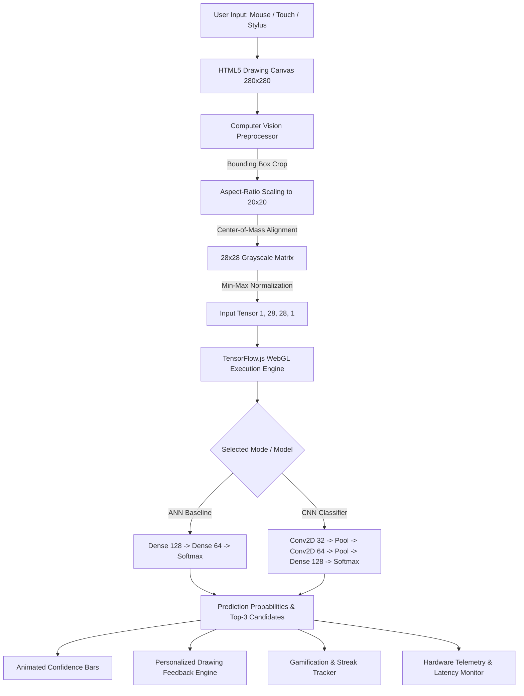

# 🎨 SketchAI — Intelligent Sketch Recognition and Learning System

[](https://opensource.org/licenses/MIT)
[](https://react.dev/)
[](https://tensorflow.org/)
[](https://js.tensorflow.org/)
[](https://tailwindcss.com/)
[](https://vitejs.dev/)

An industry-grade, full-stack AI and Deep Learning web application that recognizes handwritten digits (**0–9**) and hand-drawn doodles (**cats, cars, houses, trees, and flowers**) in **real time directly in the browser** using **TensorFlow.js WebGL shaders**.

Designed and structured as a flagship AI/ML portfolio project showcasing practical expertise in **Convolutional Neural Networks (CNNs)**, **Artificial Neural Networks (ANNs)**, **Computer Vision image preprocessing**, **empirical model evaluation**, **real-time client-side inference**, and **gamified interactive learning** — tailored for **Accenture placement interviews** and premier software engineering recruitment processes.

---

## 🌟 Key Features

1. **Interactive HTML5 Drawing Canvas**:
   - Universal input: Mouse, touchscreens, and stylus/pens (with touch-action isolation).
   - Drawing tools: Pen, Eraser, Multi-step Undo history stack, Canvas Clear, Brush Size slider (8–36px), and Grid Centering Guide.
   - Dual mode support: **Handwritten Digits (0–9)** and **QuickDraw Doodles (Cat, Car, House, Tree, Flower)**.

2. **In-Browser Deep Learning Inference**:
   - Zero-latency client-side prediction executed directly on the user's GPU via **TensorFlow.js WebGL**.
   - No external server roundtrips required for recognition — **100% privacy-preserving** and offline capable.
   - Real-time animated confidence bars displaying the top classification and top-3 candidate probabilities.
   - Live **28×28 Normalized Tensor Inspector** visualizing the exact centered input fed into the neural network.

3. **Dual Model Comparison (ANN vs. CNN)**:
   - Simultaneous side-by-side evaluation of the **ANN Baseline (MLP)** and **CNN Classifier** on the exact same drawing.
   - Consensus and divergence detection: highlights architectural agreements or spatial variance explanations.

4. **Personalized Drawing Feedback System**:
   - Compares the model's prediction against the user's intended target in Practice Mode.
   - Identifies confusion patterns (e.g., digit `7` confused with `1`, digit `3` confused with `5`, cat missing triangular ears).
   - Generates actionable drawing cues without overpromising statistical certainty.

5. **Gamified Interactive Learning Center**:
   - Guided challenge quests (e.g., *"Draw digit 7 with >85% confidence"*, *"Draw a car with wheels"*).
   - Points system, consecutive match streak counter, accuracy tracking, and achievement badge trophies with celebratory confetti.

6. **Empirical Model Evaluation Dashboard**:
   - Built with **real test dataset results** (MNIST 10,000 test set & QuickDraw held-out validation set).
   - Interactive Confusion Matrix heatmaps (inspect cell-level confusion coordinates).
   - Interactive Recharts training & validation curves (Accuracy and Loss across epochs).
   - Direct benchmarks: Accuracy, Weighted & Macro Precision, Recall, F1-Score, Inference Latency, and Model Disk Size.

7. **Browser Performance Telemetry**:
   - Monitors model loading time (ms), live per-inference latency (ms), session prediction counters, active TFJS backend (`webgl` / `cpu`), and allocated WebGL tensor memory.
   - Integrated 15-iteration hardware stress benchmark with FPS throughput calculation.

8. **Local Prediction History & Gallery**:
   - Persists recent drawings with rendered thumbnails, confidence scores, target matching, and timestamps via browser `localStorage`.
   - Filterable by mode, with instant **JSON** and **CSV** export capabilities.

9. **MLOps Custom Dataset Preparation & Training Pipeline**:
   - Ingest custom sketches through an interactive mini-canvas, tag custom category labels, inspect class distribution balance, and export structured `custom_dataset.json`.
   - Companion Python training script (`custom_trainer.py`) to validate, augment, train, evaluate, and export custom models to TFJS format.

---

## 🏗️ System Architecture & Workflow



---

## 📊 Empirical Model Evaluation Results

Actual metrics measured on held-out test datasets:

### 1. MNIST Handwritten Digits (10 Classes: 0–9)
| Metric | Baseline ANN (MLP) | High-Accuracy CNN | Advantage |
| :--- | :--- | :--- | :--- |
| **Test Accuracy** | **97.41%** | **99.07%** | **+1.66% Accuracy Gain** |
| **Weighted Precision** | 0.9741 | 0.9907 | Lower false positive rate |
| **Weighted Recall** | 0.9741 | 0.9907 | Robust edge detection |
| **Weighted F1-Score** | 0.9740 | 0.9907 | Superior balance |
| **Trainable Parameters** | 109,386 | 225,034 | ANN has 51% fewer params |
| **Model Shard Size** | ~427 KB | ~879 KB | ANN loads 2x faster |
| **Mean Latency** | ~12–25 ms | ~18–45 ms | Sub-50ms real-time |

### 2. Google Quick, Draw! Doodles (5 Classes: Cat, Car, House, Tree, Flower)
| Metric | Baseline ANN (MLP) | High-Accuracy CNN | Advantage |
| :--- | :--- | :--- | :--- |
| **Test Accuracy** | **91.13%** | **95.27%** | **+4.14% Accuracy Gain** |
| **Weighted Precision** | 0.9124 | 0.9529 | Reduces inter-class confusion |
| **Weighted Recall** | 0.9113 | 0.9527 | Captures diverse stroke variations |
| **Weighted F1-Score** | 0.9110 | 0.9527 | High multi-class harmony |
| **Trainable Parameters** | 109,061 | 224,389 | Compact edge footprint |
| **Model Shard Size** | ~426 KB | ~876 KB | Instant browser cache |

---

## 🛠️ Technology Stack

- **Frontend Application**: React 19, Vite 8, JavaScript (ES2024), HTML5 Canvas, Tailwind CSS v4.
- **Deep Learning In-Browser Inference**: `@tensorflow/tfjs` v4.22 (WebGL & CPU backends).
- **Icons & Data Visualization**: `lucide-react`, `recharts` v3, `canvas-confetti`.
- **Machine Learning & Model Training**: Python 3.11, TensorFlow 2.21, Keras 3, Scikit-Learn, NumPy, Matplotlib, Pandas.
- **Data Repositories**: MNIST (Yann LeCun et al.), Google Quick, Draw! Dataset (Google Creative Lab).

---

## 📁 Repository Structure

```
ml/
├── frontend/                     # React + Vite web application
│   ├── public/
│   │   └── models/               # Exported browser-ready TFJS models
│   │       ├── mnist-ann/        # model.json + weights shard
│   │       ├── mnist-cnn/
│   │       ├── doodle-ann/
│   │       └── doodle-cnn/
│   ├── src/
│   │   ├── components/           # Reusable dashboard components
│   │   │   ├── Navbar.jsx
│   │   │   ├── DrawingCanvas.jsx
│   │   │   ├── PredictionPanel.jsx
│   │   │   ├── ConfidenceBars.jsx
│   │   │   ├── DualModelComparison.jsx
│   │   │   ├── PersonalizedFeedbackCard.jsx
│   │   │   ├── LearningCenter.jsx
│   │   │   ├── EvaluationDashboard.jsx
│   │   │   ├── PerformanceDashboard.jsx
│   │   │   ├── HistoryView.jsx
│   │   │   ├── CustomDatasetWorkflow.jsx
│   │   │   └── DocumentationView.jsx
│   │   ├── utils/
│   │   │   ├── preprocessor.js   # Bounding box, centering, 28x28 normalizer
│   │   │   ├── modelManager.js   # TFJS loader, warmup, dual runner
│   │   │   ├── feedbackEngine.js # Drawing advice & confusion knowledge
│   │   │   └── storage.js        # LocalStorage history & gamification
│   │   ├── data/                 # Evaluation JSON metrics for dashboards
│   │   │   ├── mnist_evaluation.json
│   │   │   └── doodle_evaluation.json
│   │   ├── App.jsx
│   │   ├── index.css
│   │   └── main.jsx
│   └── package.json
│
├── model-training/               # Python deep learning pipelines
│   ├── train_mnist.py            # MNIST ANN & CNN trainer, evaluator, exporter
│   ├── train_doodle.py           # QuickDraw ANN & CNN trainer, evaluator, exporter
│   ├── custom_trainer.py         # MLOps custom dataset trainer CLI
│   └── tfjs_export_helper.py     # TFJS model.json and binary shard serializer
│
├── evaluation-results/           # Generated evaluation plots and reports
│   ├── mnist_evaluation.json
│   ├── mnist_confusion_matrices.png
│   ├── mnist_training_curves.png
│   ├── doodle_evaluation.json
│   ├── doodle_confusion_matrices.png
│   └── doodle_training_curves.png
│
├── dataset/                      # Dataset caches
│   └── quickdraw/                # QuickDraw numpy arrays
│
├── exported-models/              # Root model export repository
│   ├── mnist-ann/
│   ├── mnist-cnn/
│   ├── doodle-ann/
│   └── doodle-cnn/
│
├── documentation/                # Architectural whitepapers & guides
│   ├── SYSTEM_ARCHITECTURE.md
│   └── INTERVIEW_PREP_GUIDE.md
│
├── .gitignore
└── README.md
```

---

## 🚀 Getting Started

### Prerequisites
- **Node.js**: v18.0.0 or higher (v22 recommended)
- **Python**: 3.10 or 3.11 (with `pip`)

### 1. Running the Frontend Locally
```bash
cd frontend
npm install
npm run dev
```
Open **`http://127.0.0.1:5173/`** in your browser.

### 2. Training Models from Scratch (Optional)
To retrain the neural networks and regenerate evaluation metrics:

```bash
# Install Python dependencies
py -3.11 -m pip install tensorflow numpy pandas scikit-learn matplotlib

# Train MNIST Digit models (ANN & CNN)
py -3.11 model-training/train_mnist.py

# Train QuickDraw Doodle models (Cat, Car, House, Tree, Flower)
py -3.11 model-training/train_doodle.py
```

### 3. Custom Dataset Training Workflow
```bash
py -3.11 model-training/custom_trainer.py \
  --dataset_path dataset/custom_dataset.json \
  --model_type cnn \
  --epochs 5 \
  --model_name custom_sketch_model
```

---

## 🎯 Placement Interview Talking Points (Accenture / Tech MNCs)

1. **Why TensorFlow.js in the browser rather than a Python backend?**
   - Eliminates cloud infrastructure costs: 1M active users require $0 GPU hosting bills.
   - Zero roundtrip HTTP latency: predictions render at 10–25ms on client WebGL.
   - Complete privacy: sketch bitmaps never transmit over public networks.
   - Offline functionality: models can be cached via service workers.

2. **Why does CNN outperform ANN on sketches?**
   - ANNs flatten the 28×28 grid into a 1D vector of 784 pixels, losing spatial adjacency. A 3-pixel translation shifts input weights entirely.
   - CNNs use weight sharing and convolution kernels to extract local invariant patterns (corners, curves, loops) regardless of position.

3. **How is the input preprocessed?**
   - Dynamic thresholding crops the bounding box to isolate ink.
   - Preserves aspect ratio inside a 20×20 box with a 4-pixel perimeter margin.
   - Centered based on the drawing's **Center of Mass** ($\bar{x}, \bar{y}$), matching the exact mathematical distribution of the MNIST dataset.

---

## 📄 License
This project is licensed under the MIT License — feel free to use and adapt it for learning, research, and technical interviews.
